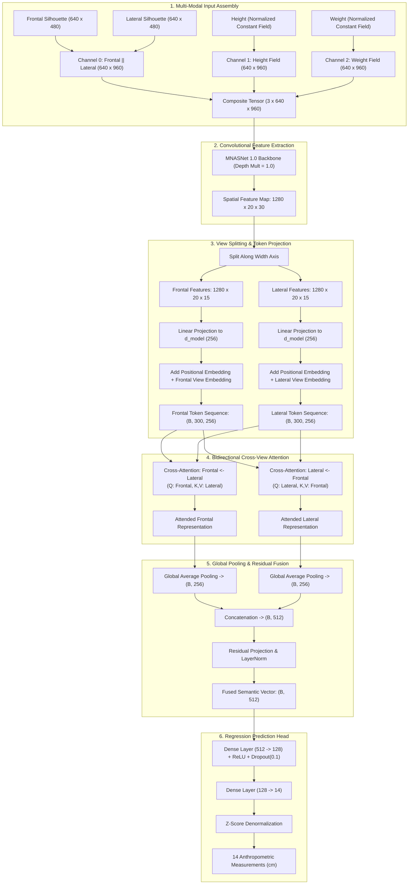

# Release v1.0.0 — BM2-Net: Dual-View Body Measurement Estimation Network

## Overview

BM2-Net is a deep learning framework designed to estimate complete 3D anthropometric body measurements directly from two orthographic silhouette masks (frontal and lateral views) combined with basic physical parameters (height and weight).

The system addresses the ill-posed problem of 3D human body measurement from 2D imagery by coupling a lightweight convolutional feature extractor with a bidirectional cross-view transformer attention mechanism, achieving sub-centimeter to low-centimeter mean absolute error across 14 standardized anatomical measurements.

---

## Architectural Specification



### 1. Composite Input Representation
The input tensor $\mathbf{X} \in \mathbb{R}^{3 \times 640 \times 960}$ encodes geometry and global biometrics across three aligned channels:
- **Channel 0 (Orthographic Geometry):** The frontal silhouette ($640 \times 480$) and lateral silhouette ($640 \times 480$) are horizontally concatenated to form a composite $640 \times 960$ array, normalized using dataset-wide silhouette pixel statistics ($\mu = 0.1491, \sigma = 0.3546$).
- **Channel 1 (Height Prior):** The subject's total standing height is normalized ($z$-score) and broadcast uniformly across a $640 \times 960$ matrix.
- **Channel 2 (Weight Prior):** The subject's body weight is normalized ($z$-score) and broadcast uniformly across a $640 \times 960$ matrix.

### 2. MNASNet Backbone
Features are extracted using an MNASNet 1.0 convolutional backbone, optimized for mobile latency and spatial feature resolution. For an input dimension of $640 \times 960$, the backbone produces a latent feature map $\mathbf{F} \in \mathbb{R}^{1280 \times 20 \times 30}$.

### 3. Token Projector & Embeddings
The feature map $\mathbf{F}$ is partitioned along the width dimension into two halves:
- Frontal feature grid: $\mathbf{F}_{\text{front}} \in \mathbb{R}^{1280 \times 20 \times 15}$ (300 spatial tokens).
- Lateral feature grid: $\mathbf{F}_{\text{lat}} \in \mathbb{R}^{1280 \times 20 \times 15}$ (300 spatial tokens).

Each spatial token is projected into a $d_{\text{model}} = 256$ dimensional space via a linear projection layer followed by Layer Normalization and Dropout ($p = 0.1$). Learned 1D positional embeddings $\mathbf{E}_{\text{pos}} \in \mathbb{R}^{1 \times 300 \times 256}$ and view embeddings $\mathbf{E}_{\text{view}} \in \mathbb{R}^{2 \times 256}$ are added to retain spatial structure and orientation identity.

### 4. Bidirectional Cross-View Attention
To resolve spatial ambiguities (e.g., distinguishing torso depth from limb occlusion), the network executes two-way cross-view multi-head attention:
- **Frontal Query Attention:** Frontal tokens query lateral keys and values to capture anatomical depth.
  $$\mathbf{Z}_{\text{front}} = \text{MHA}\left(Q = \mathbf{T}_{\text{front}}, K = \mathbf{T}_{\text{lat}}, V = \mathbf{T}_{\text{lat}}\right)$$
- **Lateral Query Attention:** Lateral tokens query frontal keys and values to capture coronal breadth.
  $$\mathbf{Z}_{\text{lat}} = \text{MHA}\left(Q = \mathbf{T}_{\text{lat}}, K = \mathbf{T}_{\text{front}}, V = \mathbf{T}_{\text{front}}\right)$$

Both cross-attention streams incorporate multi-head projections ($h = 8$ heads, $d_k = 32$), residual additions, and Layer Normalization.

### 5. Pooling and Fusion Block
Token sequences are compressed via global average pooling across the token dimension ($N = 300$):
$$\mathbf{v}_{\text{front}} = \frac{1}{N}\sum_{i=1}^{N} \mathbf{Z}_{\text{front}}^{(i)}, \quad \mathbf{v}_{\text{lat}} = \frac{1}{N}\sum_{i=1}^{N} \mathbf{Z}_{\text{lat}}^{(i)}$$

The vectors are concatenated into $\mathbf{v}_{\text{cat}} = [\mathbf{v}_{\text{front}} \,\|\, \mathbf{v}_{\text{lat}}] \in \mathbb{R}^{512}$, processed through a linear residual block, and stabilized with Layer Normalization:
$$\mathbf{v}_{\text{fused}} = \text{LayerNorm}\left(\mathbf{v}_{\text{cat}} + \text{Dropout}\left(\mathbf{W}_{\text{res}} \mathbf{v}_{\text{cat}}\right)\right)$$

### 6. MLP Prediction Head
The fused 512-dimensional vector is projected to the 14 measurement outputs through a two-layer multi-layer perceptron:
$$\hat{\mathbf{y}}_{\text{norm}} = \mathbf{W}_2 \cdot \text{ReLU}\left(\mathbf{W}_1 \mathbf{v}_{\text{fused}} + \mathbf{b}_1\right) + \mathbf{b}_2$$
where $\mathbf{W}_1 \in \mathbb{R}^{128 \times 512}$ and $\mathbf{W}_2 \in \mathbb{R}^{14 \times 128}$.

Outputs are denormalized using target statistics to produce real-world centimeters:
$$\hat{y}_i = \hat{y}_{\text{norm}, i} \cdot \sigma_i + \mu_i$$

---

## Target Anthropometric Measurements

The model concurrently regresses 14 anatomical parameters covering all major ISO/anthropometric measuring planes:

| Index | Measurement | Metric Type | Primary Anatomical Plane |
| :---: | :--- | :--- | :--- |
| 1 | **Ankle Circumference** | Circumference | Minimum girth above the malleoli |
| 2 | **Arm Length** | Linear | Acromion landmark to styloid process (wrist) |
| 3 | **Bicep Circumference** | Circumference | Maximum girth of relaxed upper arm |
| 4 | **Calf Circumference** | Circumference | Maximum horizontal girth of the gastrocnemius |
| 5 | **Chest Circumference** | Circumference | Fullest part of thorax over bust/nipple plane |
| 6 | **Forearm Circumference** | Circumference | Maximum girth of the forearm distal to elbow |
| 7 | **Body Height** | Linear | Vertical distance from vertex to floor |
| 8 | **Hip Circumference** | Circumference | Maximum horizontal girth around buttocks |
| 9 | **Leg Length** | Linear | Crotch/perineum to floor landmark (inseam) |
| 10 | **Shoulder Breadth** | Linear | Biacromial breadth across outer shoulder edges |
| 11 | **Shoulder to Crotch** | Linear | Vertical torso distance from clavicle to perineum |
| 12 | **Thigh Circumference** | Circumference | Maximum upper leg girth directly below gluteal fold |
| 13 | **Waist Circumference** | Circumference | Minimum circumference of natural waist indentation |
| 14 | **Wrist Circumference** | Circumference | Minimum girth measured at styloid process |

---

## Performance & Empirical Validation

Training and evaluation were conducted on the benchmark BodyM dataset. Target values were optimized using the Mean Absolute Error (MAE / $L_1$) criterion with AdamW optimization and cosine learning rate scheduling.

- **Best Validation MAE (Mean Across 14 Metrics):** **`1.006 cm`**
- **Inference Latency:**
  - GPU (NVIDIA CUDA): ~18 ms / sample
  - CPU (x86_64): ~85 ms / sample

---

## Local Inference Suite

This release introduces the complete local testing suite in `local-test/`:

### Key Features
- **Flexible Photo & Silhouette Input:** Accepts camera photos (`.jpg`, `.png`, `.avif`) with automated segmentation or pre-extracted silhouette masks.
- **Polarity Auto-Correction:** Checks boundary corner values and automatically corrects inverted masks (ensuring foreground $= 255$, background $= 0$).
- **Unit Conversion Engine:** Accepts height in cm, meters, inches, or feet-and-inches (`5ft 10`, `5'10"`, `70in`), and weight in kg or pounds (`165lbs`, `75kg`).
- **Comprehensive Output Generation:**
  - `report_<timestamp>.png`: Rendered visual infographic showing dual input views, physical statistics (BMI, height, weight), and measurement card.
  - `measurements_<timestamp>.json`: Machine-readable structured payload.
  - `measurements_<timestamp>.csv`: Spreadsheet-ready data.
  - `silhouettes/`: Preprocessed, normalized input masks.

### Usage Example

```bash
# Direct execution with photos/masks
python local-test/predict.py --frontal front.jpg --lateral side.jpg --height 178 --weight 75

# Execution with imperial units
python local-test/predict.py --frontal front.png --lateral side.png --height "5ft 10" --weight 165lbs

# Interactive mode (prompts for inputs with drag-and-drop file support)
python local-test/predict.py

# Out-of-the-box verification on bundled samples
python local-test/sample_run.py
```

---

## Checkpoint & Dependencies

- Checkpoint weight file: `train/checkpoints/best_model.pt`
- Python requirement: `>= 3.12`
- Core dependencies: `torch >= 2.0`, `torchvision >= 0.15`, `pillow`, `pandas`, `numpy`
